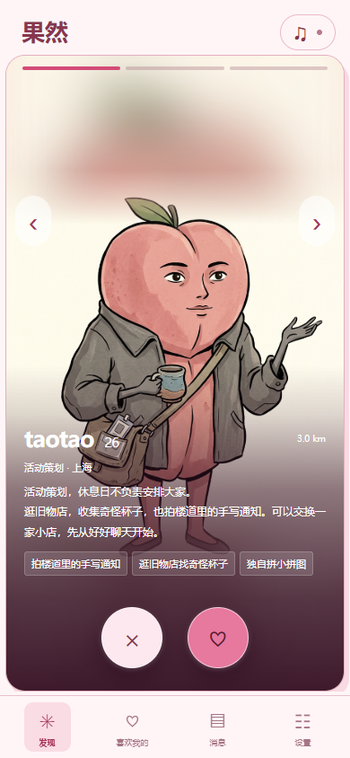
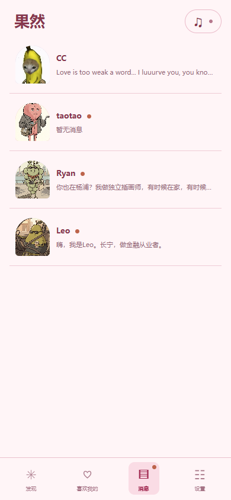
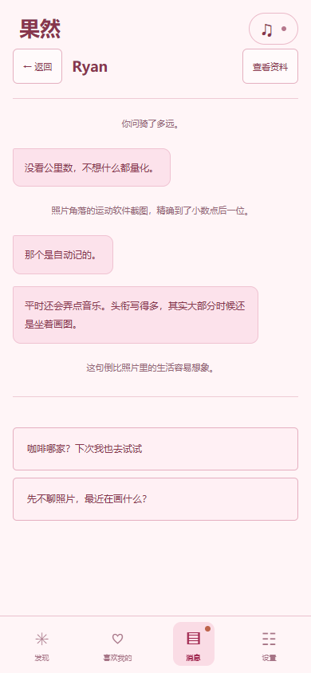

# 果然 · 上海 Dating 模拟器

为 **cococamp #11 Game Jam** 制作的网页游戏 demo，主题是 **「果」**。

## 从一场都市约会说起

右滑、匹配、喝咖啡、吃晚饭。散步时气氛刚好，一个吻之后，你以为故事终于开始了。第二天，回复却越来越短；几天后，对方的动态照常更新，你的消息停在已读。

快餐恋爱、crush 上头、暧昧拉扯、忽然 ghost，以及那种见过几次就忍不住期待以后、反复猜测一句回复的「晕船」——这些都市约会话题，是《果然》的创作引子。有人想认真认识，有人只想短暂停留；身体已经靠近，对关系的理解却可能还隔着很远。


*创作灵感参考：社交平台上的个人约会经历分享，原作者信息保留在截图中。*

《果然》把这些期待、欲望和误会装进水果的身体，让玩家亲自经历：一次匹配，究竟是相遇的开始，还是另一轮熟练的开场白？

下班了，来认识一点新鲜水果。在这个虚构的上海交友软件里，你可以滑卡、匹配、聊天、约见，同时认识几位成年水果居民，让关系走向友情、恋爱、亲密或告别。人是果，每次右滑也要结果。

## 游戏截图

| 滑卡发现 | 多线消息 | 选项聊天 |
| :---: | :---: | :---: |
|  |  |  |

## 从「果」开始

看到题目，首先想到的是伊甸园里的禁忌之果：好奇、诱惑，以及伸手之后要面对的选择。创作中，也把「果儿」联想到风月场中的人，让这个词带上一点欲望、暧昧与自我展示的意味。于是，水果走进了 dating app，开始写简介、挑照片、等回复。

水果的身体弱化了性别，吸引与关系可以跨越性别和物种。不同的 species 构成虚构族群，与职业、资源、生活方式交织，映照现实中的种族、阶层，以及因爱好、性格而形成的人群。这些映射是流动的：同一种水果也有不同处境、不同脾气和不同的关系期待。

故事发生在通勤、房租、加班和精致约会之间。主页上努力经营的人设，会在聊天和相处中慢慢露出另一面。基调轻松荒诞，带一点上海都市生活的黑色幽默。

短篇里也有买单时的尴尬：有人每次都说「回头转你」「下次我来」，真正提到 AA 却当场翻脸。你可以再给一次机会，也可以在下一次约会开始前说算了。

## 如何打开游戏

1. **下载并解压：**在 GitHub 仓库页面点击「Code → Download ZIP」，下载后完整解压到一个文件夹。已经拿到项目压缩包的话，直接解压即可。
2. **用浏览器打开：**进入解压后的项目文件夹，找到 `index.html`，双击打开。建议使用 Chrome 或 Edge；如果双击打开的是编辑器，右键选择「打开方式」，再选择浏览器。
3. **进入游戏：**点击画面中的「果然」Logo，确认已满 18 岁，即可进入「发现」页开始滑卡。

直接试玩无需安装 Node.js 或运行命令。请保留 `index.html`、`play.js`、`src/` 和 `public/` 的目录结构，图片、样式和音乐会从这些文件夹加载。GitHub 网页中的 `index.html` 展示的是源码，游玩时请打开解压后的本地文件。

## 如何进行游戏

1. **熟悉界面：**进入后，底部有「发现」「喜欢我的」「消息」「设置」四个页签。电脑和手机使用同一套竖屏界面。
2. **滑卡认识新朋友：**在「发现」查看照片、自我介绍和爱好。有多张照片时，点击左右箭头切换；左滑或点击「×」跳过，右滑或点击「♡」表达兴趣。
3. **等待匹配：**右滑后不会立即开始聊天，也不保证每次都匹配。「消息」页会显示等待回应的状态；匹配成功时会出现通知，点击「去聊天」即可进入对话，也可以稍后从「消息」页打开。
4. **阅读并回复：**进入聊天，消息和旁白会逐条出现。等这一段显示完，再点击下方的回复选项继续。游戏采用选项对话，不需要输入文字；点击「查看资料」可以重新浏览对方的主页和相册。
5. **切换不同关系：**点击「返回」或底部页签，可以去跟别人聊天、继续滑卡。普通角色出现等待提示时，换个页面、进行别的操作，或过几分钟再回来，就能继续下一段。
6. **按约定见面：**桃子的主线采用现实时间。看到「下次联系」就按显示的日期再来；有预约时，在你当地时间的约定窗口内点击「我到场了」。也可以按界面提示改约，或取消约见、保持朋友。
7. **做出自己的选择：**可以同时认识几位角色，继续靠近、只做朋友、暂不回复，或结束关系。一段故事结束后，点击结局下方的「回到消息」，还能继续其他人的故事。首次试玩可以先体验普通角色的短篇，再慢慢推进桃子主线。

在聊天中点击「查看资料 → 解除关系」，对方会移出消息列表。之后可以到「设置 → Archive」回看解除前已看到的聊天和对方资料；归档中的关系不会再收到消息或继续剧情。

每天最多浏览 20 位候选，滑完后等待当地次日。当前「喜欢我的」只显示模糊头像，VIP 尚未开放，不会实际收费。

右上角音乐按钮点击播放，再次点击暂停。进度会自动保存在当前浏览器；「设置」里可以调整字号、查看 Archive，或通过「删除存档并重新开始」重新游玩。删除存档会清除已有进度及 Archive，换浏览器或设备也不会自动同步。

角色均为成年人。内容涉及成人关系、性暗示与约会中的情感困境，适合 18 岁及以上玩家。

## 开发运行

开发环境需要 Node.js 22.12 或更高版本：

```sh
npm install
npm run dev
```

使用原生 JavaScript、HTML、CSS 与 Vite 开发。当前为 Game Jam demo，详细设计见 [GDD](Docs/上海dating模拟器-GDD.md)。
