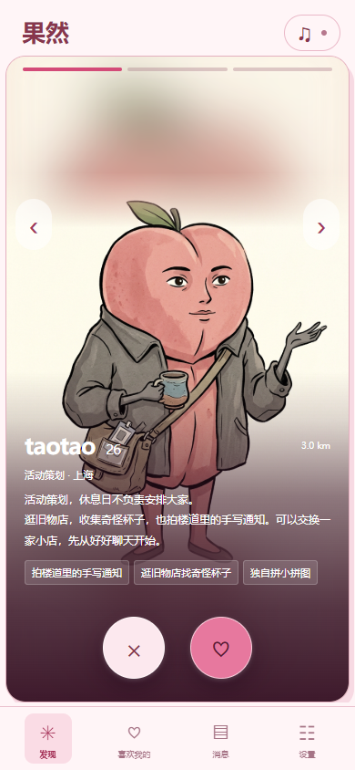
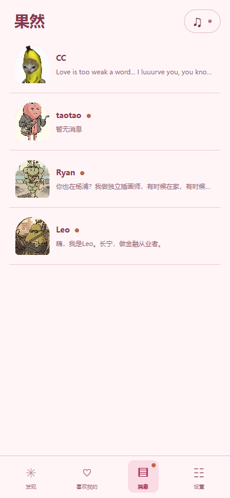
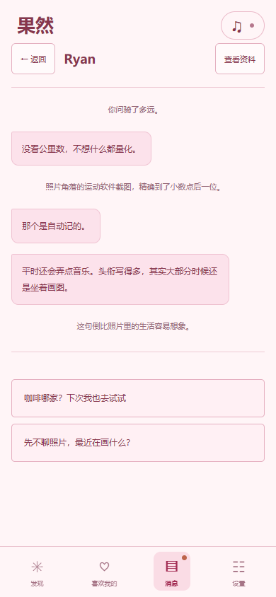

# Guoran · A Shanghai Dating Simulator

A web demo made for **cococamp #11 Game Jam**. The theme is **果** — fruit.

## It starts with a city date

Swipe right, match, coffee, dinner. The walk feels right, and after a kiss you think the story has finally started. The next day the replies get shorter. A few days later their posts keep coming, and your message sits on read.

Fast dating, a crush that hits too hard, a maybe that never lands, a sudden ghost, and that particular seasickness of having met someone a few times and already reading a future into one reply — those city-dating feelings are where *Guoran* starts. Some people want to know you properly. Some only want to stay a little while. Bodies can be close while the two of you still mean different things by it.


*Reference only: a personal dating story shared on social media. The original author's details stay in the screenshot.*

*Guoran* puts that hope, desire, and misunderstanding into a fruit's body, and lets you find out for yourself whether a match is the start of knowing someone, or one more practiced opening line.

Work is over. Come meet some fresh fruit. Inside this fictional Shanghai dating app you swipe, match, text, and meet, and you can get to know several adult fruit residents at once. A relationship can become friendship, love, intimacy, or a goodbye. Everyone is a fruit, and every right swipe has to come to something.

## Screenshots

| Discover | Several chats | Choose a reply |
| :---: | :---: | :---: |
|  |  |  |

## Starting from 果

The first association is the forbidden fruit in Eden: curiosity, temptation, and the choice you face once you reach. In the making of the game, 果儿 — a word for someone in the world of romance and sex work — lent the same word a little desire, flirtation, and self-display. So the fruit moved into a dating app, wrote a bio, picked their photos, and waited on a reply.

A fruit body softens gender. Attraction and relationships can cross gender and species. The species are fictional peoples. Work, money, and way of life weave through them, and glance at race, class, and the crowds people form around a hobby or a temperament. The glance stays loose: the same fruit can live a different life, keep a different temper, and want a different kind of relationship.

The story sits between the commute, the rent, the overtime, and the carefully arranged date. The persona someone works hard to keep up on their profile comes apart, slowly, in the chat and in the time you spend together. The tone is light and absurd, with a little of the black humor of daily life in Shanghai.

The short stories include the awkwardness of the bill. Someone keeps saying they'll transfer it later, or that the next one is on them, and then turns on you the moment you suggest splitting it. You can give them another chance, or call it off before the next date starts.

## How to open the game

1. **Download and unzip.** On the GitHub repository page, choose Code → Download ZIP, then unzip the whole archive into a folder. If you already have the project zip, unzip that.
2. **Open it in a browser.** Go into the unzipped folder, find `index.html`, and double-click it. Chrome or Edge works best. If a double-click opens an editor, right-click the file, choose Open with, and pick a browser.
3. **Enter the game.** Click the 果然 logo, confirm that you are 18 or older, and you land on 发现 (Discover), ready to swipe.

You can play without installing Node.js or running a command. Keep `index.html`, `play.js`, `src/`, and `public/` in the same places relative to each other. Pictures, styles, and music load from those folders. The `index.html` view on GitHub shows the source. To play, open the unzipped file on your computer.

## How to play

1. **Learn the screen.** Along the bottom are four tabs: 发现 (Discover), 喜欢我的 (Likes), 消息 (Messages), and 设置 (Settings). A computer and a phone share the same tall screen.
2. **Swipe to meet someone.** On Discover, look at the photos, the bio, and the interests. If there is more than one photo, use the arrows. Drag left or press × to pass. Drag right or press ♡ to say you want to know them. The bio sits in the lower part of the card; drag inside that band to read the rest.
3. **Wait on a match.** A right swipe does not open a chat, and it does not promise a match. Messages shows 等待回应 (waiting on a reply) while a like is still out. When a match lands, a notice appears; 去聊天 opens that chat, or you can open it later from Messages. An ordinary match may take a few hours, or one to three days on your clock. Peach, Lemon, and Durian answer much sooner. Some likes never come back, and the game does not announce those.
4. **Read, then answer.** In a chat, their lines appear one after another. When that stretch finishes, choose a reply underneath. You pick from the written options. There is no text box. 查看资料 opens their profile and photos again.
5. **Move between people.** 返回, or the tabs, takes you to someone else or back to swiping. When an ordinary resident is still living their own day, switch pages, do something else, or come back in a few minutes, and the next part can continue.
6. **Show up when you said you would.** Peach's story uses real time. When you see 下次联系, come back on the date it shows. If you have a plan, press 我到场了 during the window in your local time. You can also move the plan, or cancel it and stay friends, following the prompt on screen.
7. **Choose for yourself.** You can know several people at once. You can move closer, stay friends, leave a chat unanswered, or end it. After a story finishes, 回到消息 under the ending takes you back to everyone else. On a first play, the short stories are an easy place to start. Peach's story is the long one.

In a chat, 查看资料 → 解除关系 removes them from Messages. After that, 设置 → Archive keeps the profile and the chat you had already read. An archived relationship gets no new messages and no more story.

You can look at 20 people a day. When they are gone, wait until the next local day. Likes shows blurred portraits for now. VIP is not open, and the game does not charge you.

The music button at the top right plays on the first click and pauses on the next. Progress saves itself in the current browser. In Settings you can change the type size, open Archive, or choose 删除存档并重新开始. Deleting the save clears the progress and Archive. A different browser or device does not pick the save up.

Beside the 果然 title, a small **debug** control can move a waiting clock forward by one day or three, so a playtest does not have to sit through Peach's weeks. It leaves VIP closed, and a pass stays a pass.

Every character is an adult. The game includes adult relationships, sexual suggestion, and the emotional trouble of dating. It is for players 18 and older.

## Development

The dev environment needs Node.js 22.12 or newer:

```sh
npm install
npm run dev
```

The game is plain JavaScript, HTML, and CSS, built with Vite. This is a game-jam demo. The design notes are in the [GDD](Docs/上海dating模拟器-GDD.md). Sections 1–11 are in Chinese. From section 12 on, the notes continue in English.
